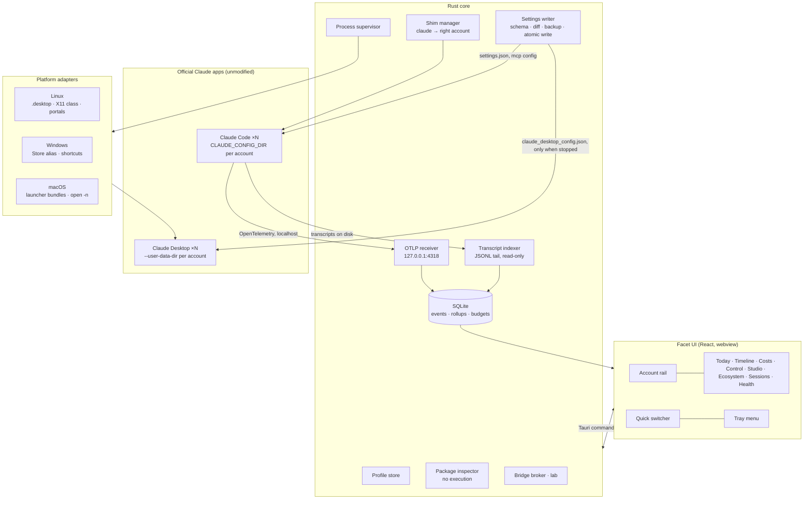

# Architecture

## Stack
- **Shell:** Tauri 2 (Rust core, system webview). Same stack as cc-switch (148k★) and opcode, proven at scale.
- **UI:** React + TypeScript + Vite. Canvas for the Timeline. Tokens from `docs/05-design/tokens.css`.
- **Storage:** SQLite (rusqlite, WAL mode) in the app data folder. One file, local only.
- **Telemetry intake:** an embedded OTLP/HTTP receiver on `127.0.0.1` (protobuf and JSON).
- **Official plugins:** tray, single-instance, autostart, updater (signed), global-shortcut (X11/Windows/macOS), opener, fs, shell (scoped).

## Big picture



## Components
| Component | Responsibility | Key rules |
|---|---|---|
| Profile store | Accounts, colours, folders, surfaces, plan. `profiles.toml` + SQLite mirror. | Holds no secrets. |
| Process supervisor | Launch, focus, quit, watch Desktop instances; open terminals as an account. | Scrubs override env vars; official binary only. |
| Settings writer | Read effective settings (user, project, local, managed); validate; diff; backup; atomic write. | Never writes managed policy; Desktop config only when stopped. |
| OTLP receiver | Accept Claude Code metrics and events from each account on localhost. | Binds 127.0.0.1 only; maps events to profiles by `user.account_uuid` (optional per-account port as a second key); never overrides `OTEL_RESOURCE_ATTRIBUTES` for Desktop profiles; drops or hashes `user.email` on ingest (D-011). |
| Transcript indexer | Tail `<config>/projects/**/*.jsonl` for timestamps, tool ids, usage. | Read-only; parser tolerant of format changes; stores no content unless capture is on. |
| Studio library | Local git-backed library of skills, agents, commands, hooks, plugins; templates; linter; placement into accounts and projects with drift detection. Formats in `EXTENSION-SURFACE.md`. | No secrets in the library; every write backed up and diffed; every item passes the package inspector. |
| Studio runner | User-started `claude -p`, `claude plugin validate`, `claude plugin eval` in a chosen account for drafting and tests; local hook dry-runs. | Official binary only; override variables scrubbed; cost ceiling shown first; no network calls by Facet itself. |
| Search index | SQLite FTS5 (trigram) over session metadata, and message text only after opt-in. | Local only; rule 9. |
| Package inspector | Parse skill, plugin and MCP manifests and scripts statically; produce the safety preview. | Never executes the package. |
| Shim manager | Install a `claude` shim on PATH that picks the account by folder rules. | Execs the real Claude Code unmodified. |
| Bridge broker | Lab. Handoff files by default; native cross-account messaging only if Anthropic documents it (D-010). | User-triggered only; walls via `crossSessionInbound`; registry JSON parsed with an allow-list, `.key` files never opened. |
| Health | Run checks; offer safe fixes. | Fixes are reversible. |

## Telemetry wiring per account
Facet writes into each account's `settings.json` `env` (with a backup and a diff the user approves):
```json
{
  "CLAUDE_CODE_ENABLE_TELEMETRY": "1",
  "OTEL_METRICS_EXPORTER": "otlp",
  "OTEL_LOGS_EXPORTER": "otlp",
  "OTEL_EXPORTER_OTLP_PROTOCOL": "http/json",
  "OTEL_EXPORTER_OTLP_ENDPOINT": "http://127.0.0.1:43NN"
}
```
Each account gets its own local port (`43NN`), which is the second key next to `user.account_uuid`. Facet does **not** set `OTEL_RESOURCE_ATTRIBUTES`: a `settings.json` value replaces the process value entirely, and Claude Desktop sets its own on its Code children (test 3, D-011). `OTEL_LOG_USER_PROMPTS` stays unset unless the user enables prompt capture for that account. Verified in test 3 (`spikes/03-otel-per-account/README.md`).

## Data flow for one model call
1. Claude Code (account Work) finishes an API request and emits a `claude_code.api_request` log event with tokens, cost, duration and `session.id`.
2. The OTLP receiver accepts it, maps it to a profile by `user.account_uuid` (and the port it arrived on), drops `user.email`, writes one row to `events`, and bumps `rollup_minute`.
3. The indexer later sees the matching transcript line and fills `task_id` and the tool-call join if OTel lacked it.
4. The UI, subscribed to `events:new`, redraws the Timeline and Today.

## Failure modes
| Failure | Effect | Handling |
|---|---|---|
| Claude changes OTel fields | Missing columns | Versioned mappers; Health warns; transcript fallback |
| Claude changes transcript format | Joins degrade | Tolerant parser; feature flags per field |
| Claude update breaks multi-instance | Accounts won't open | Adapter version checks; Health explains; fall back to one-at-a-time |
| Port 4318 busy | No telemetry | Pick a free port and rewrite env with consent |
| Anthropic ships native multi-account | Isolation less valuable | Timeline, costs, control and safety still apply; adopt native switching |
